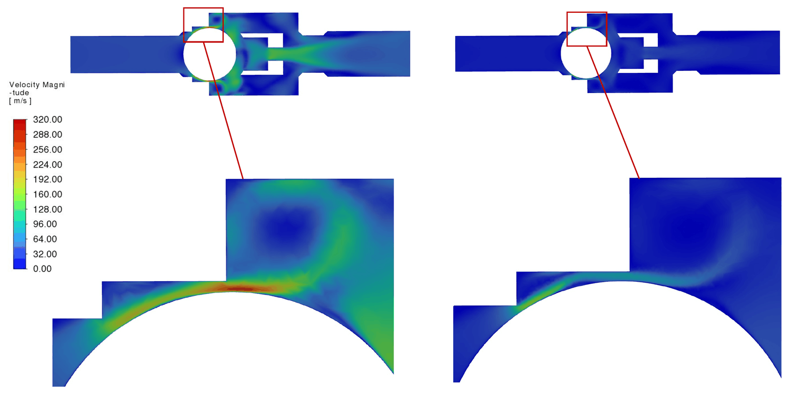
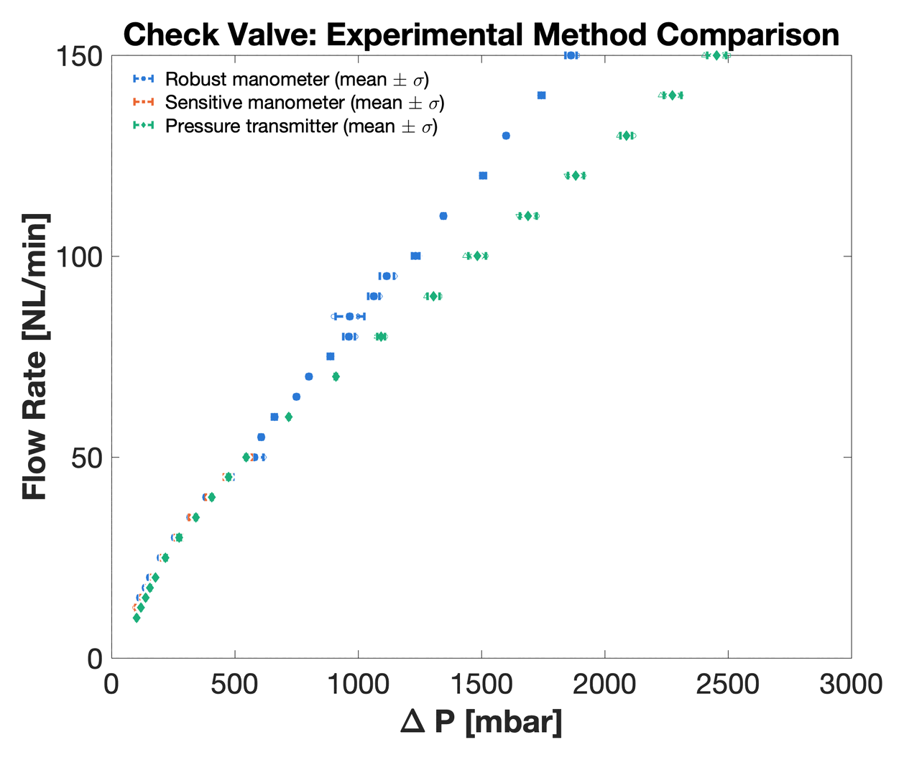
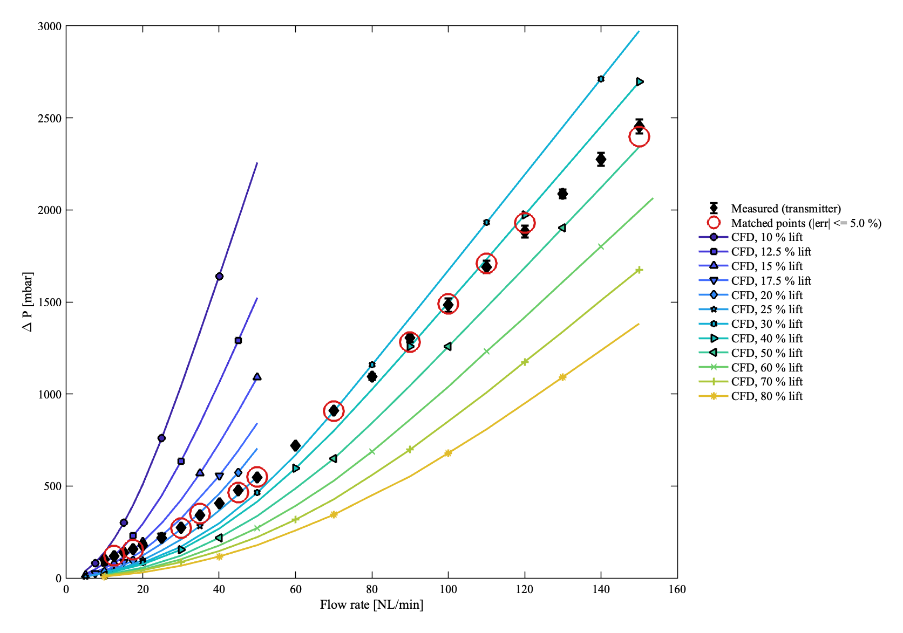
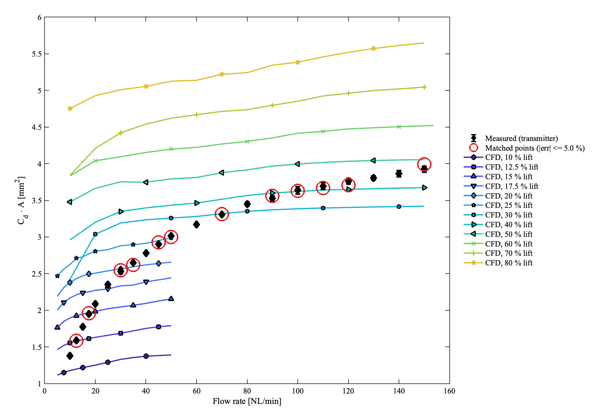
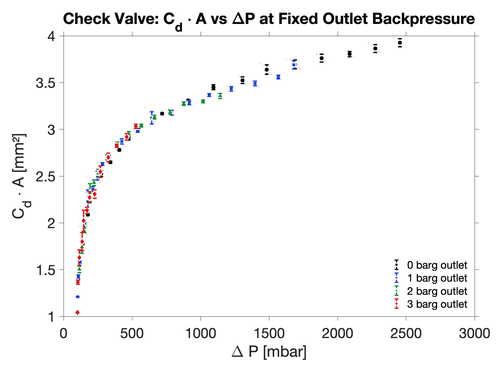

# Check valve CFD

Steady 3-D CFD, flow experiments and a 0-D dynamic model of the spring-loaded ball check valves of a
high-pressure reciprocating nitrogen booster, the Logos Kimya YB690. Matching fixed-ball CFD to
measured pressure drops recovers how far the ball opens and how much effective flow area the valve
passes, which the compressor models need and which cannot be measured on the sealed valve. This is
part of my MSc thesis at the Middle East Technical University (2026).

## Introduction

<p align="center">
  
  <br><em>Air through the valve: velocity magnitude on the symmetry plane at two fixed ball positions, gap enlarged below.</em>
</p>

Each cylinder of the booster has a suction and a discharge valve: a ball held on its seat by a light
spring. How far the ball lifts, and how much flow area that exposes, set the pressure overshoot at
discharge, the undershoot at suction and the mass delivered per cycle. A flow test gives only the
product C_d*A, and the ball sits inside a sealed steel body, so its lift has to be inferred.

## Part of the compressor project

This page is one piece of the [Reciprocating compressor CFD](https://github.com/astralisxx/reciprocating-compressor-cfd) work:

- The valve model characterised here drives the suction and discharge valves of the transient 3-D
  compressor CFD, coupled through user-defined functions.
- The same model drives the valves of the 0-D compressor models and all four valves of the
  [LOGOS-YB690 Booster](https://github.com/astralisxx/logos-yb690-booster) simulator.
- The valves set when gas enters and leaves the cylinder, so their description directly controls the
  delivered flow the compressor models predict. The wall heat loss, the other main input, is covered
  in [Compressor heat transfer](https://github.com/astralisxx/compressor-heat-transfer).

## What I did

- **Steady 3-D CFD in ANSYS Fluent** with k-omega SST on a half model, the ball fixed at 10 % to 80 %
  of its travel and a flow-rate sweep at each position, on a polyhedral-hexcore mesh with boundary
  layers resolved in the ball-body gap.
- **Flow experiments** in air (5 to 150 NL/min, outlet at atmosphere or held at 1 to 3 barg) with two
  manometers and a pressure transmitter, after a water test that proved the method.
- **Inverse matching**: where a fixed-ball CFD curve meets the measured pressure drop within 5 %, that
  position is the inferred lift.
- **Compressible orifice law** (Saint-Venant-Wantzel) with an approach-velocity correction, inverted to
  obtain the measured effective area C_d*A.
- **0-D ball model**: a spring-mass-damper with a sphere drag law and real-gas (Peng-Robinson)
  properties, driving the valves of the 0-D compressor models and, through user-defined functions,
  of the 3-D compressor CFD.
- **Quasi-steady validity check** from the unsteady Bernoulli equation, evaluated on the 3-D
  compressor CFD and weighted by delivered mass.

```
Ball:      m_v*x'' = C_D(Re)*A_f*dP - c_v*x' - k_v*x,      0 <= x <= x_max
Orifice:   mdot = C_d*A_v(x)*sqrt(rho_up*P_up)*Psi(r, gamma) / sqrt(1 - C_d^2*r^(2/gamma)*(A_v(x)/A_port)^2)
Validity:  eps = L_eff/(u*tau_p) < 0.1
```

C_D is the sphere drag coefficient, Psi the isentropic flow function of r = P_dn/P_up, L_eff the
inertance length and tau_p the time scale of the pressure change.

## Results

<p align="center">
  
  <br><em>Three pressure instruments, outlet at atmosphere (mean ± 1 standard deviation); the transmitter repeats best and is the reference.</em>
</p>

<p align="center">
  
  <br><em>Measured pressure drop against CFD at fixed ball positions; circles mark the 12 points matched within 5 %.</em>
</p>

**Lift rises with flow.** The matched points give a ball position that climbs steadily with flow rate:

| Flow rate (NL/min) | Inferred ball position (% of travel) |
|---|---|
| 12.5 | 12.5 |
| 45 to 50 | 25 |
| 90 to 120 | 40 |
| 150 | 50 |

<p align="center">
  
  <br><em>The same comparison as effective area C_d*A; the measured C_d*A flattens above about 100 NL/min.</em>
</p>

<p align="center">
  
  <br><em>Measured C_d*A against pressure drop at four outlet pressures, 0 to 3 barg.</em>
</p>

**C_d*A does not depend on backpressure.** Once the compressible orifice law has absorbed the
downstream density, the effective area should depend only on the lift. The four sets collapse onto
one C_d*A(dP) curve, within 3 % above 400 mbar: the physical check on the method.

## Limits

- **Low pressure only.** The tests reach 3 barg at the outlet and about 2.5 bar of pressure drop; the
  compressor valves work at 40 bar and above (up to 690 bar in the second stage). Whether the
  C_d*A(dP) curve carries over to dense nitrogen is untested.
- **Fixed ball, lift inferred.** The CFD is steady, with the ball held still and the springs and cage
  left out. A 5 % match identifies a ball position but is not by itself a validation; the checks are
  the steady rise of lift with flow and the backpressure independence of C_d*A.
- **Quasi-steady flow law.** The suction valve is quasi-steady (0.61 % of its gas passes while
  eps > 0.1); at the discharge valve 10.2 % does, in narrow spikes at opening and seating.
- **No reverse flow.** The orifice law cannot flow backwards. In the 0-D model the pressure difference
  reverses during about 17 % (suction) and 24 % (discharge) of the open time, so the delivered mass is
  over-estimated.

## Related work

- A. B. Şimşek, B. Erdoğan, N. B. Üner, "Computational Design of a High-Pressure Compressor and Its
  Experimental Validation", ICCHMT 2025, Lecture Notes in Mechanical Engineering, Springer, pp.
  390-399, 2026. https://doi.org/10.1007/978-3-032-16138-3_36
- F. Turgut, A. B. Şimşek, N. B. Üner, B. Erdoğan, "Analysis of a High-Pressure Reciprocating
  Compressor Piston's 2D Simulation Utilizing Computational Fluid Dynamics", ICBASET 2024, The
  Eurasia Proceedings of Science, Technology, Engineering and Mathematics, vol. 28, pp. 352-359,
  2024. https://doi.org/10.55549/epstem.1523562
- MSc thesis: "Experimental and Numerical Design of a High-Pressure Reciprocating Compressor", METU,
  2026. Chapter 6 covers the valve characterisation.
- A journal manuscript on the compressor models and their validation is in preparation.
- A valve model of this form drives the valves of the 3-D cylinder CFD in [Reciprocating compressor
  CFD](https://github.com/astralisxx/reciprocating-compressor-cfd) and all four valves of the
  [LOGOS-YB690 Booster](https://github.com/astralisxx/logos-yb690-booster) desktop simulator.

## Files

This repository holds only this page and its figures. The CFD cases, meshes, user-defined functions,
MATLAB models and measured data are private.

Copyright (c) 2026 Ahmet Berkay Şimşek. All rights reserved. The figures may not be reused without
permission.
